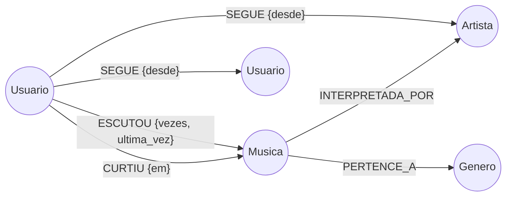

# 🎵 Sistema de Recomendação de Músicas com Grafos (Neo4j)

Projeto desenvolvido como desafio do curso de Neo4j/Cypher. Modela usuários, músicas, artistas e gêneros como um grafo e usa consultas Cypher para gerar recomendações personalizadas com base nas conexões.

## 📐 Modelo do grafo

| Nó | Propriedades |
|---|---|
| `Usuario` | `id`, `nome`, `cidade` |
| `Musica` | `id`, `titulo`, `ano`, `duracao_seg` |
| `Artista` | `id`, `nome`, `pais` |
| `Genero` | `id`, `nome` |

| Relacionamento | Propriedades | Significado |
|---|---|---|
| `ESCUTOU` | `vezes`, `ultima_vez` | Usuário ouviu a música |
| `CURTIU` | `em` | Usuário curtiu a música |
| `SEGUE` | `desde` | Usuário segue um artista ou outro usuário |
| `INTERPRETADA_POR` | — | Música pertence ao artista |
| `PERTENCE_A` | — | Música pertence ao gênero |

## 🧠 Estratégias de recomendação

1. **Filtragem colaborativa**: quem curtiu as mesmas músicas que você também curtiu...
2. **Por gênero favorito**: músicas dos gêneros que você mais ouve (peso pela quantidade de reproduções).
3. **Artistas seguidos**: músicas dos artistas que você segue e ainda não ouviu.
4. **Social**: o que as pessoas que você segue estão ouvindo.
5. **Híbrida**: junta as estratégias com pesos (colaborativa = 3, artista = 2, gênero = 1) e gera um ranking final.

Todas as consultas excluem músicas que o usuário já escutou ou curtiu.

## ▶️ Como executar

1. Crie um banco gratuito no [Neo4j Aura](https://neo4j.com/cloud/aura-free/) ou use o Neo4j Desktop / Sandbox.
2. Abra o **Neo4j Browser** (ou Query).
3. Cole e execute o arquivo `recomendacao_musicas.cypher` por blocos:
   - Seção 1: constraints
   - Seções 2 e 3: carga dos dados (com `MERGE`, pode rodar mais de uma vez sem duplicar)
   - Seções 4 e 5: consultas de exploração e recomendação

## ✅ Resultado esperado (recomendação híbrida para a usuária Ana)

| Música | Artista | Score |
|---|---|---|
| Caminhos | Os Andarilhos | 7 |
| Fogo Lento | Os Andarilhos | 7 |
| Brilho | Luna Vega | 4 |
| Maré | Clara Mar | 4 |
| Batida Solar | DJ Pulso | 3 |

Faz sentido: a Ana ouve muito Rock, segue Os Andarilhos e tem gosto parecido com o Bruno, que curte essas músicas.

## 🛠️ Boas práticas aplicadas

- **Constraints de unicidade** nos IDs, para evitar nós duplicados.
- **`MERGE` em vez de `CREATE`** na carga, para o script ser idempotente.
- **`UNWIND`** para carregar listas de dados de forma compacta.
- **`NOT EXISTS { }`** para filtrar o que o usuário já conhece.
- **`CALL (eu) { ... UNION ALL ... }`**: subquery com escopo de variável (sintaxe atual do Cypher 25) para somar as pontuações da recomendação híbrida.

Testado no Neo4j AuraDB Free (Cypher 25): 27 nós e 63 relacionamentos.
